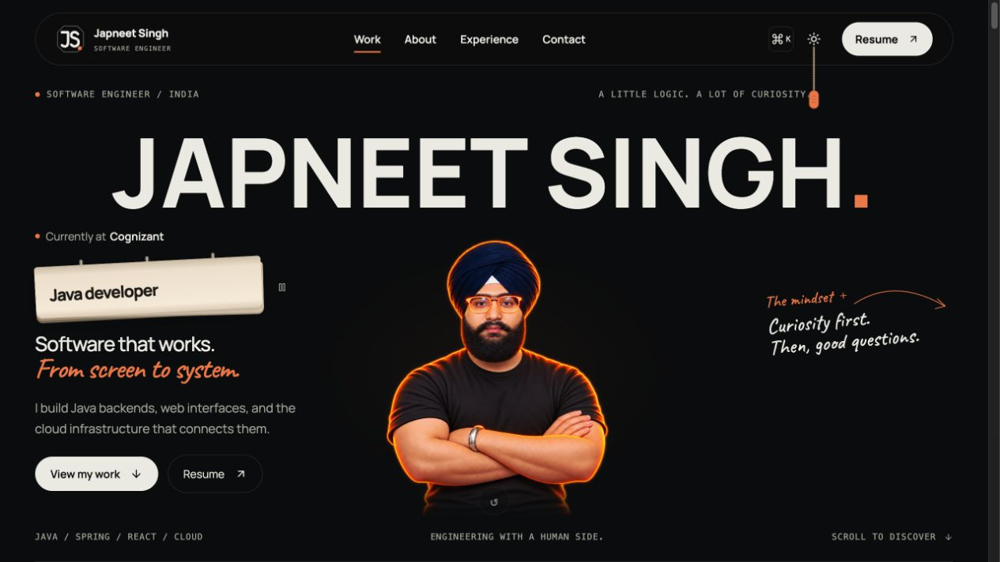

# Japneet Singh — Portfolio

A responsive developer portfolio with project case studies, experience, research, and contact details.

[**Visit the portfolio**](https://orcus01.github.io/Portfolio/)



## Features

- Searchable project case studies with screenshots and engineering details.
- Responsive navigation and accessible project dialogs.
- Persistent light/dark themes and reduced-motion support.
- Interactive engineering layers, experience, and research links.
- A public GitHub repository snapshot and direct contact links.

## Run locally

Install Node.js and npm, then:

```sh
git clone https://github.com/Orcus01/Portfolio.git
cd Portfolio
npm ci
npm run dev
```

```sh
npm run build       # production build for root-path hosting
npm run preview     # preview the build locally
npm run build:pages # build for /Portfolio/ on GitHub Pages
```

## Stack

React · Vite · Tailwind CSS · shadcn/ui · Motion

## Content

- `src/data/portfolio.js`: projects, experience, skills, and contact details.
- `src/data/caseStudies.js`: case-study copy and evidence labels.
- `src/data/github.json`: public repository metadata; refresh with `npm run sync:github`.
- `src/assets/`: portrait illustration and project imagery.
- `src/components/ProjectVisual.jsx`: project captures and the LabConnect architecture overview.

Seats & Spaces is a commercial website with private source code. Its portfolio entry links to the public storefront. This repository contains the portfolio itself.

Project captures show existing interfaces, not performance benchmarks. The portrait illustration is shared with the profile assets. Research and experience links are included alongside the relevant case studies.

## Publishing

`main` contains source; `gh-pages` contains the generated site. Build with `npm run build:pages`, then publish the contents of `dist/` to `gh-pages`.
